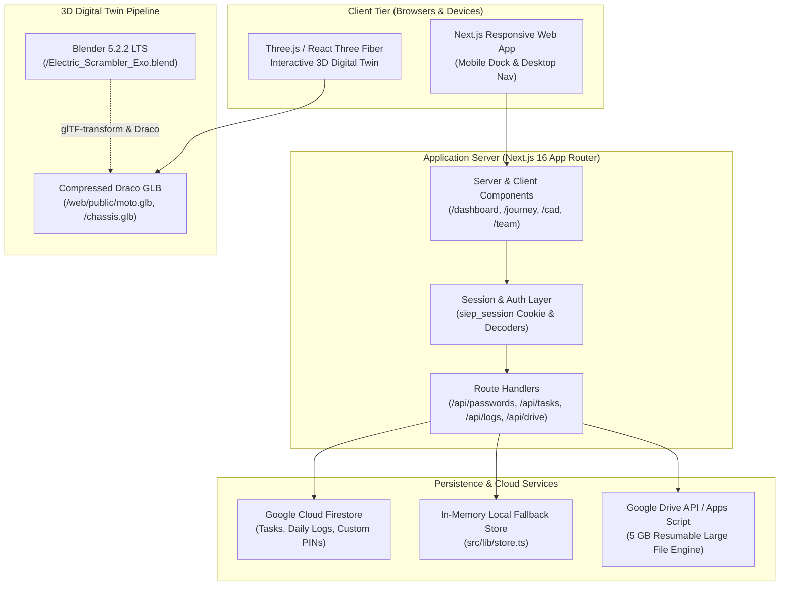

# 🏛️ RIDERS BAY SYSTEM ARCHITECTURE
> **Comprehensive System Topology & Technical Specification**  
> *Project: Riders Bay Smart Scrambler E-Bike | SIEP Season 7.0 (ISIEINDIA)*  
> *Institution: SNJB's KBJ College of Engineering, Chandwad*  
> *Companion Documents:* [.context/DATABASE.md](file://.context/DATABASE.md) | [.context/CONTEXT.md](file://.context/CONTEXT.md) | [.context/HANDOVER.md](file://.context/HANDOVER.md)

---

## 🗺️ 1. HIGH-LEVEL SYSTEM TOPOLOGY



---

## 💻 2. WEB APPLICATION ARCHITECTURE (`/web`)

### Tech Stack
- **Framework:** Next.js `16.4.5` (App Router)
- **Runtime:** React `19.3.0` & React DOM `19.3.0`
- **Styling:** Tailwind CSS `v4` with `@tailwindcss/turbopack`
- **3D Graphics:** Three.js `0.186.1`, `@react-three/fiber` `9.8.1`, `@react-three/drei` `10.7.9`, `three-stdlib`
- **Animation:** GSAP `3.15.0` (ScrollTrigger, Flip, Tween)
- **Database / Auth:** Firebase SDK `13.0.0` (Cloud Firestore & Auth) + Custom PIN Engine

### Directory Breakdown
```
web/
├── public/                # Static assets, .glb models, audio, team imagery
│   ├── moto.glb           # 1.4 MB full scrambler motorcycle 3D model
│   └── chassis.glb        # 1.0 MB spaceframe chassis isolated 3D model
├── src/
│   ├── app/               # Next.js App Router endpoints & views
│   │   ├── api/           # Serverless API routes (passwords, tasks, logs, drive)
│   │   ├── dashboard/     # Engineering Command Center & Kanban
│   │   ├── journey/       # Timeline & Milestones
│   │   ├── cad/           # Interactive 3D CAD inspection suite
│   │   ├── team/          # Official Team Roster & Squad Directory
│   │   └── page.tsx       # Marketing Landing Page & Hero 3D Stage
│   ├── components/        # Reusable UI components & 3D canvases
│   ├── context/           # React context providers (AuthContext.tsx)
│   └── lib/               # Utility libraries, types, and persistence layer
```

---

## 🔐 3. AUTHENTICATION & ACCESS CONTROL TIERS

The system employs a fast, frictionless **Dual-Layer PIN Authentication Model** designed for team operations in the workshop without complex password resets.

```
┌────────────────────────────────────────────────────────┐
│               TIER 1: CORE ADMINS (Tier 1)             │
│  - Unrestricted task creation, editing & deletion      │
│  - Member password resets & squad administration       │
│  - Milestone sign-offs & export access                 │
└──────────────────────────┬─────────────────────────────┘
                           │
┌──────────────────────────┴─────────────────────────────┐
│               TIER 2: SQUAD LEADS (Tier 2)             │
│  - Squad-level task management & sprint planning       │
│  - Approvals for daily logs within domain              │
│  - Priority assignment for subsystem work              │
└──────────────────────────┬─────────────────────────────┘
                           │
┌──────────────────────────┴─────────────────────────────┐
│              TIER 3: SQUAD MEMBERS (Tier 3)            │
│  - Personal task tracking & Kanban drag/drop status    │
│  - Daily engineering log submissions                   │
│  - 6-Digit PIN self-service update                     │
└────────────────────────────────────────────────────────┘
```

- **Default PIN:** `935200` (Universal fallback for new members until customized).
- **Custom PIN Persistence:** Stored in Cloud Firestore under `settings/passwords` and cached locally in `store.ts`.
- **Domain View Scoping:** Members with primary (`teamId`) and secondary assignments (`secondaryTeams`) can filter their dashboard to view either their assigned squads or the full 9-squad fleet.

---

## 🏍️ 4. 9 ENGINEERING SQUADS MATRIX

| Squad ID | Domain | Primary Focus |
| :--- | :--- | :--- |
| `chassis` | Spaceframe & Ergonomics | AISC 4130 Chromoly tubular chassis, TIG welding, torsional stiffness |
| `powertrain` | Motor & Drivetrain | 5 kW peak BLDC mid-drive, reduction chain, sprocket ratios |
| `battery` | Energy Storage & BMS | 72V 40Ah Li-ion pack, active cell balancing, monocoque enclosure |
| `electronics` | Low Voltage & Power | PDU, 72V-to-12V DC-DC converters, wiring harness, harness looms |
| `telemetry` | CAN Bus & Software | ESP32 microcontrollers, 500kbps CAN 2.0B, cloud telemetry |
| `brakes` | Hydraulic Braking | Dual-disc hydraulic calipers, regenerative blending, master cylinder |
| `suspension` | Dynamics & Damping | Inverted front forks (USD), adjustable rear monoshock, swingarm |
| `safety` | High Voltage & Failsafes | Master Disconnect Switch (MDS), insulation monitoring, crash inertia cut |
| `marketing` | Media & Sponsorship | Digital presence, competition documentation, sponsor decks |
| `core` | Team Leadership | Project management, budget allocation, technical compliance |

---

## 📦 5. 5 GB GOOGLE DRIVE RESUMABLE UPLOAD ENGINE

To circumvent Vercel and serverless 4.5 MB request payload limits:
1. Client requests an authorized upload URI from `/api/drive/resumable-session`.
2. Next.js communicates with Google Apps Script / Drive API using service account credentials.
3. The client browser streams the binary directly in 256 KB chunks to the Google Drive session endpoint.
4. On completion, Google Drive registers the file ID and saves the metadata to Cloud Firestore.
