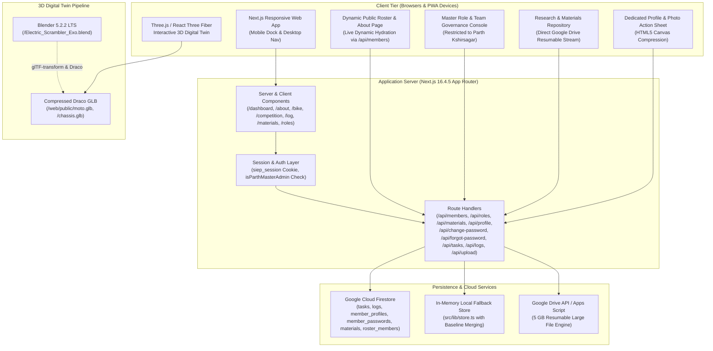

# 🏛️ RIDERS BAY SYSTEM ARCHITECTURE
> **Comprehensive System Topology & Technical Specification**  
> *Project: Riders Bay Smart Scrambler E-Bike | SIEP Season 7.0 (ISIEINDIA)*  
> *Institution: SNJB's KBJ College of Engineering, Chandwad*  
> *Companion Documents:* [.context/DATABASE.md](file://.context/DATABASE.md) | [.context/CONTEXT.md](file://.context/CONTEXT.md) | [.context/DECISIONS.md](file://.context/DECISIONS.md) | [.context/HANDOVER.md](file://.context/HANDOVER.md)  
> *Last Synced:* 2026-11-13 (Daily Codebase Context Sync)

---

## 🗺️ 1. HIGH-LEVEL SYSTEM TOPOLOGY



---

## 💻 2. WEB APPLICATION ARCHITECTURE (`/web`)

### Tech Stack
- **Framework:** Next.js `16.4.5` (App Router with Turbopack & Partial Prefetching)
- **Runtime:** React `19.3.0` & React DOM `19.3.0`
- **Styling:** Tailwind CSS `v4` with `@tailwindcss/turbopack`
- **3D Graphics:** Three.js `0.186.1`, `@react-three/fiber` `9.8.1`, `@react-three/drei` `10.7.9`, `three-stdlib`
- **Animation:** GSAP `3.15.0` (ScrollTrigger, Flip, Tween)
- **Database / Auth:** Firebase SDK `13.0.0` (Cloud Firestore & Auth) + Custom PIN, Role Governance & Profile Engine
- **PWA Service Worker:** `siep-pwa-v2` with client-side cache auto-purge

### Directory Breakdown
```
web/
├── public/                # Static assets, .glb models, audio, icons, team imagery
│   ├── moto.glb           # 1.4 MB full scrambler motorcycle 3D model
│   ├── chassis.glb        # 1.0 MB spaceframe chassis isolated 3D model
│   └── sw.js              # Service worker (v2 cache invalidation)
├── src/
│   ├── app/               # Next.js App Router endpoints & views
│   │   ├── api/           # Serverless API routes:
│   │   │   ├── members/          # Public dynamic team members endpoint (GET)
│   │   │   ├── roles/            # Master role management (GET/POST - restricted to Parth)
│   │   │   ├── materials/        # Research & Materials repo (GET/POST/DELETE)
│   │   │   ├── profile/          # Member profile sync (GET/POST)
│   │   │   ├── change-password/  # Direct PIN changes
│   │   │   ├── forgot-password/  # OTP email recovery relay
│   │   │   ├── tasks/            # Kanban task mutations & queries
│   │   │   ├── logs/             # Daily engineering build logs
│   │   │   ├── upload/           # File upload handling
│   │   │   ├── contact/          # Contact form relay
│   │   │   └── store/backup/     # State snapshots
│   │   ├── dashboard/     # Engineering Command Center, Kanban, Workbench & Tabs
│   │   ├── materials/     # Dedicated Research & Materials Repository route
│   │   ├── roles/         # Master Roles & Team Governance route (Parth only)
│   │   ├── tasks/         # Dedicated Task Workspace route
│   │   ├── teams/         # Dedicated Subsystems & Teams directory route
│   │   ├── reports/       # Dedicated Velocity & Progress Reports route
│   │   ├── build-log/     # Dedicated Build Log timeline route
│   │   ├── profile/       # Dedicated Member Profile route
│   │   ├── about/         # Team Roster, History & Public Bios (/about#team)
│   │   ├── bike/          # Vehicle specifications & 3D showcase
│   │   ├── competition/   # SIEP 7.0 rulebook & milestone tracker
│   │   ├── log/           # Daily workshop engineering log archive
│   │   ├── login/         # PIN authentication portal
│   │   └── page.tsx       # Marketing Landing Page & Hero 3D Stage
│   ├── components/        # Reusable UI components & 3D canvases
│   │   ├── dashboard/     # MaterialsTab.tsx, RolesManagementTab.tsx, SubsystemsTab.tsx,
│   │   │                  # TeamTasksTab.tsx, VelocityMetricsTab.tsx, DashboardOverviewTab.tsx,
│   │   │                  # CredentialsVaultTab.tsx, MyWorkbenchTab.tsx
│   │   ├── profile/       # ProfileView.tsx, PinChangeForm.tsx
│   │   ├── navigation/    # BottomNav.tsx (Instagram dock), Navigation.tsx (Desktop top bar)
│   │   ├── shared/        # OperationsBanner.tsx, StatCard.tsx, CreateTaskModal.tsx
│   │   └── TeamSection.tsx# Dynamic public roster section (hydrates from /api/members)
│   ├── context/           # React context providers (AuthContext.tsx)
│   └── lib/               # Utility libraries, types, and persistence layer
│       ├── firestoreService.ts  # Firestore SDK connectors (tasks, logs, profiles, passwords, materials, members)
│       ├── members.ts           # 23-member directory baseline, getMemberDomains(), isParthMasterAdmin()
│       ├── store.ts             # In-memory and session fallback store with baseline merging
│       ├── session.ts           # Cookie session encoding/decoding
│       ├── teams.ts             # Team domain definitions and metadata
│       └── types.ts             # TypeScript domain definitions (Task, WorkLog, ResearchMaterial, etc.)
```

---

## 🔐 3. AUTHENTICATION & ACCESS CONTROL ARCHITECTURE

The system implements a fast, workshop-optimized **Multi-Tier Identity & Role Governance Architecture** tailored for pit-lane execution without complex passwords.

```
┌────────────────────────────────────────────────────────┐
│      MASTER ROLE AUTHORITY (Parth Kshirsagar Only)     │
│  - Unilateral team appointments (Captain, Vice Capt)   │
│  - Lead appointments, multi-domain assignments         │
│  - Permission revocation (1-click back to Tier 3)      │
│  - Master password inspection/editing & PFP management │
│  - Guarded by isParthMasterAdmin() cryptographic gate  │
└──────────────────────────┬─────────────────────────────┘
                           │
┌──────────────────────────┴─────────────────────────────┐
│               TIER 1: CORE ADMINS (4 Members)          │
│  - Unrestricted task creation, editing & deletion      │
│  - Sprint management & all-squad visibility            │
│  - Material deletion & milestone sign-offs             │
└──────────────────────────┬─────────────────────────────┘
                           │
┌──────────────────────────┴─────────────────────────────┐
│               TIER 2: SQUAD LEADS                      │
│  - Domain task management & sprint planning            │
│  - Approvals for daily logs within domain              │
│  - Priority assignment for subsystem work              │
└──────────────────────────┬─────────────────────────────┘
                           │
┌──────────────────────────┴─────────────────────────────┐
│              TIER 3: SQUAD INNOVATORS / MEMBERS        │
│  - Personal task tracking & Kanban drag/drop status    │
│  - Daily engineering log submissions                   │
│  - Research & technical materials upload (unrestricted)│
│  - Profile customization (Photo, Display Name, Bio)    │
│  - 6-Digit PIN self-service update (Default: 935200)   │
└────────────────────────────────────────────────────────┘
```

### Key Security Invariants
- **Default PIN:** `935200` (Universal fallback for new members until customized).
- **Custom PIN Persistence:** Stored in Cloud Firestore under `member_passwords/{cleanEmail}` with automatic email alias sync (`parthkshirsagrr@gmail.com` <-> `parthkshirsagr@gmail.com`).
- **Master Admin Guard (`isParthMasterAdmin`):** Restricts the Role Management console UI, navigation pill, and `/api/roles` endpoint exclusively to Parth Kshirsagar. Any unauthorized access receives HTTP 403 Forbidden.
- **Direct PIN vs. OTP Recovery:**
  - If the current PIN is known, users change it instantly in `PinChangeForm.tsx`.
  - If forgotten, `/api/forgot-password` dispatches a 6-digit OTP code to the member's registered Gmail via Google Apps Script relay.

---

## ⚖️ 4. ABSOLUTE DOMAIN EQUALITY (ZERO PARTIALITY)

As established in ADR-021:
- **No Primary/Secondary Bias:** The legacy concept of "primary vs. secondary domains" is completely removed. All squad allocations are stored in `domains: TeamId[]` with 100% equal standing.
- **Visual Uniformity:** All assigned squads render identical badges with equal prominence. No squad or title is ever forced or prioritized over another.
- **Square Bracket Codes Isolated:** Domain shortcodes (e.g. `[MECH] [DSGN] [RES] Meet Samdadiya`) appear **strictly in the Roles Management console table** for quick administrative scanning. In all other views (navigation, user profile, Teams tab, task cards, public website), members have clean names with zero bracket prefixes.
- **Dynamic Public Roster Sync:** Public components (`TeamSection.tsx`, `/about#team`) and portal tabs (`SubsystemsTab.tsx`) fetch real-time member records from `/api/members`. When Parth updates roles or domains, changes propagate immediately across the entire platform.

---

## 👤 5. MEMBER PROFILE & IDENTITY ARCHITECTURE

- **Client-Side Compression:** Profile photos are cropped 1:1 and compressed via HTML5 Canvas into lightweight WebP/JPEG data URLs (~20–35 KB).
- **Firestore Persistence:** Stored under `member_profiles/${cleanEmail}` (`displayName`, `photoUrl`, `bio`, `updatedAt`).
- **Master PFP & Password Governance:** Parth can view, update, or remove member profile photos and view/update member PINs directly inside the Master Roles console.
- **Synchronized UI Elements:**
  - Dashboard Profile View (Dedicated full-screen tab, hidden header/KPI ribbon for clutter-free UX).
  - Native Photo Action Sheet (View Full Photo, Upload New Photo, Remove Photo, Cancel).
  - Photo Lightbox Preview modal.
  - Instagram Bottom Navigation Dock (5th avatar icon renders photo or CAD monogram).
  - Public Team Page (`/about#team`) desktop and mobile cards hydrate custom profiles dynamically.

---

## 📚 6. RESEARCH & MATERIALS REPOSITORY ARCHITECTURE

As established in ADR-019:
- **Dedicated Hub (`/materials`, `MaterialsTab.tsx`):** Provides a centralized technical library separate from daily fabrication logs.
- **Universal Contributor Model:** Every authenticated member across all 9 squads can upload technical whitepapers, CAD designs, simulation outputs, component datasheets, test reports, and research briefs.
- **Categories:** `research`, `specs`, `reports`, `datasheets`, `cad`, `other`.
- **Direct Google Drive Streaming:** Uses `uploadFileToGoogleDrive` to stream files up to 5 GB directly to the team's Google Drive via Google Apps Script resumable sessions, bypassing serverless upload limits. Live 0–100% progress tracking is provided.
- **Persistence:** Stored in Cloud Firestore collection `materials` with memory fallback in `store.ts`.

---

## 📦 7. 5 GB GOOGLE DRIVE RESUMABLE UPLOAD ENGINE

To circumvent Vercel and serverless 4.5 MB request payload limits:
1. Client requests an authorized upload URI from `/api/drive/resumable-session`.
2. Next.js communicates with Google Apps Script / Drive API using service account credentials.
3. The client browser streams the binary directly in 256 KB chunks to the Google Drive session endpoint.
4. On completion, Google Drive registers the file ID and saves the metadata to Cloud Firestore (`logs` for build videos, `materials` for research docs).

---

## 🏍️ 8. 9 ENGINEERING SQUADS & DOMAINS MATRIX

| Domain ID | Squad Name | Technical Focus |
| :--- | :--- | :--- |
| `chassis` / `mechanical` | Spaceframe & Dynamics | AISC 4130 Chromoly tubular lattice, TIG welding, FEA stress analysis |
| `powertrain` | Motor & Transmission | 5 kW peak BLDC mid-drive motor, reduction chain, sprocket ratios |
| `battery` | Energy Storage & BMS | 72V 40Ah Li-ion pack, active cell balancing, monocoque enclosure |
| `electronics` / `entc` | Low Voltage & Power | PDU, 72V-to-12V DC-DC converters, wiring harness looms, relays |
| `telemetry` / `software` | CAN Bus & Cloud IoT | ESP32-S3 microcontrollers, 500kbps CAN 2.0B, cloud telemetry, portal |
| `brakes` | Hydraulic Braking | Dual-disc hydraulic calipers, regenerative braking blending |
| `suspension` | Dynamics & Damping | Inverted front forks (USD), adjustable rear monoshock, swingarm |
| `safety` | High Voltage & Failsafes | Master Disconnect Switch (MDS), insulation monitoring, inertia cut |
| `marketing` / `sponsorship` | Media, Deck & Docs | Digital presence, competition documentation, sponsor pitch decks |
| `core` | Team Leadership | Project management, budget allocation, technical compliance |
