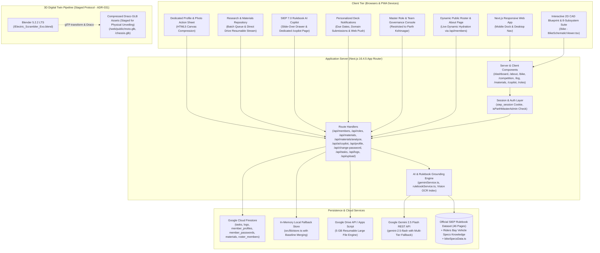

# 🏛️ RIDERS BAY SYSTEM ARCHITECTURE
> **Comprehensive System Topology & Technical Specification**  
> *Project: Riders Bay Smart Scrambler E-Bike | SIEP Season 7.0 (ISIEINDIA)*  
> *Institution: SNJB's KBJ College of Engineering, Chandwad*  
> *Companion Documents:* [.context/CODEBASE_MAP.md](file://.context/CODEBASE_MAP.md) *(Kya Cheez Kidhar Hai)* | [.context/DATABASE.md](file://.context/DATABASE.md) | [.context/CONTEXT.md](file://.context/CONTEXT.md) | [.context/DECISIONS.md](file://.context/DECISIONS.md) | [.context/HANDOVER.md](file://.context/HANDOVER.md)  
> *Last Synced:* 2026-11-15 13:20 IST (Codebase Map Sync)

---

## 🗺️ 1. HIGH-LEVEL SYSTEM TOPOLOGY



---

## 💻 2. WEB APPLICATION ARCHITECTURE (`/web`)

### Tech Stack
- **Framework:** Next.js `16.4.5` (App Router with Turbopack & Partial Prefetching)
- **Runtime:** React `19.3.0` & React DOM `19.3.0`
- **Styling:** Tailwind CSS `v4` with `@tailwindcss/turbopack`
- **3D Graphics:** Three.js `0.186.1`, `@react-three/fiber` `9.8.1`, `@react-three/drei` `10.7.9`, `three-stdlib`
- **Animation:** GSAP `3.15.0` (ScrollTrigger, Flip, Tween)
- **Database / Auth:** Firebase SDK `13.0.0` (Cloud Firestore & Auth) + Custom PIN, Role Governance & Profile Engine
- **AI Engine:** Google Gemini 2.5 Flash (`gemini-2.5-flash` with `gemini-2.5-pro`, `gemini-3.5-flash`, `gemini-flash-latest` fallback) + Deterministic Semantic Synthesis Engine + Heuristic Rule Engine
- **Rulebook & Vehicle Knowledge:** 46-page Apple Vision Neural OCR extracted index (`web/data/siep_rulebook_index.json`) + Authoritative Vehicle Specs (`EVERYTHINGUWANNAKNOW.MD`) + Master Engineering Specification Dataset (`web/src/components/bike/bikeSpecsData.ts`)
- **PWA Service Worker:** `siep-pwa-v2` with client-side cache auto-purge and background notification handlers

### Directory Breakdown
```
web/
├── data/
│   └── siep_rulebook_index.json # 46-page official SIEP Season 7.0 rulebook OCR index
├── public/                # Static assets, .glb models, audio, icons, team imagery
│   ├── moto.glb           # 1.4 MB full scrambler motorcycle 3D model (staged for physical unveiling)
│   ├── chassis.glb        # 1.0 MB spaceframe chassis isolated 3D model (staged for physical unveiling)
│   └── sw.js              # Service worker (v2 cache invalidation, push/notification handler)
├── src/
│   ├── app/               # Next.js App Router endpoints & views
│   │   ├── api/           # Serverless API routes:
│   │   │   ├── ai/copilot/       # Official SIEP Rulebook AI Copilot (GET redirect, POST query)
│   │   │   ├── members/          # Public dynamic team members endpoint (GET)
│   │   │   ├── roles/            # Master role management (GET/POST - restricted to Parth)
│   │   │   ├── materials/        # Research & Materials repo (GET/POST/DELETE)
│   │   │   ├── materials/analyze/# Multi-file batch AI analysis & squad auto-bifurcation (POST)
│   │   │   ├── profile/          # Member profile sync (GET/POST)
│   │   │   ├── passwords/        # Member & squad PIN queries
│   │   │   ├── change-password/  # Direct PIN changes
│   │   │   ├── forgot-password/  # OTP email recovery relay
│   │   │   ├── tasks/            # Kanban task mutations & queries
│   │   │   ├── logs/             # Daily engineering build logs
│   │   │   ├── upload/           # File upload handling
│   │   │   ├── contact/          # Contact form relay
│   │   │   └── store/backup/     # State snapshots
│   │   ├── copilot/       # Dedicated SIEP 7.0 Rulebook AI Copilot page
│   │   ├── dashboard/     # Engineering Command Center, Kanban, Workbench & Tabs
│   │   ├── materials/     # Dedicated Research & Materials Repository route
│   │   ├── roles/         # Master Roles & Team Governance route (Parth only)
│   │   ├── tasks/         # Dedicated Task Workspace route
│   │   ├── teams/         # Dedicated Subsystems & Teams directory route
│   │   ├── reports/       # Dedicated Velocity & Progress Reports route
│   │   ├── build-log/     # Dedicated Build Log timeline route
│   │   ├── profile/       # Dedicated Member Profile route
│   │   ├── about/         # Team Roster, History & Public Bios (/about#team)
│   │   ├── bike/          # Complete engineering showcase & CAD schematic blueprint viewer
│   │   ├── competition/   # SIEP 7.0 rulebook & milestone tracker
│   │   ├── contact/       # Team contact and partnership inquiry page
│   │   ├── log/           # Daily workshop engineering log archive
│   │   ├── login/         # PIN authentication portal
│   │   └── page.tsx       # Marketing Landing Page (High-velocity hero)
│   ├── components/        # Reusable UI components & engineering suites
│   │   ├── bike/          # The Bike Engineering Showcase Suite (ADR-031):
│   │   │   ├── bikeSpecsData.ts        # Authoritative master dataset (hotspots, subsystems, specs, CAE, trials)
│   │   │   ├── BikeHeroSection.tsx     # Display typography, mission narrative & 6-card telemetry ribbon
│   │   │   ├── BikeSchematicViewer.tsx # Interactive 2D vector blueprint, dimensions & 6 clickable hotspots
│   │   │   ├── SubsystemsExplorer.tsx  # 8-subsystem deep-dive matrix (materials, safety factors, rules)
│   │   │   ├── TechSpecsTable.tsx      # Searchable & category-filtered technical specs table
│   │   │   ├── CaeValidationSection.tsx# Structural FEA & Thermal CFD validation showcase
│   │   │   ├── ProvingGroundSection.tsx# SIEP Season 7.0 dynamic trials mapping
│   │   │   └── BikeCtaHub.tsx          # Cross-linking CTA hub to Materials, Logs, Copilot, Contact
│   │   ├── copilot/       # RulebookCopilotDrawer.tsx (Slide-out drawer), MarkdownMessage.tsx (Rich markdown)
│   │   ├── dashboard/     # MaterialsTab.tsx, RolesManagementTab.tsx, SubsystemsTab.tsx,
│   │   │                  # TeamTasksTab.tsx, VelocityMetricsTab.tsx, DashboardOverviewTab.tsx,
│   │   │                  # CredentialsVaultTab.tsx, MyWorkbenchTab.tsx
│   │   │   └── roles/     # Modular Roles Governance Suite (ADR-029):
│   │   │       ├── rolesConfig.ts, RolesToolbar.tsx, RolesStatsRibbon.tsx, RolesTable.tsx,
│   │   │       ├── ExecutiveCommandSidebar.tsx, EditMemberModal.tsx, AddMemberModal.tsx, RevokeMemberModal.tsx
│   │   ├── log/           # Modular Build Log Suite (ADR-029):
│   │   │   ├── logConfig.tsx, LogDesktopView.tsx, LogMobileView.tsx, LogMediaSidebar.tsx,
│   │   │   ├── CreateLogModal.tsx, EditLogModal.tsx, DeleteConfirmModal.tsx, MobileLogDetailDrawer.tsx
│   │   ├── navigation/    # Modular Navigation Engine (ADR-030):
│   │   │   ├── navConfig.ts, DesktopPortalNav.tsx, DesktopPublicNav.tsx, UserDropdownMenu.tsx,
│   │   │   ├── MobileSlideDrawer.tsx, GlobalMobileBottomBar.tsx, BottomNav.tsx, DashboardTabBar.tsx
│   │   ├── tasks/         # Modular Task Workspace & Modal Suite (ADR-030):
│   │   │   └── modal/     # taskModalConfig.ts, TaskModalHeader.tsx, TaskStatusSwitcher.tsx,
│   │   │                  # TaskBlockerSection.tsx, TaskMetadataSection.tsx, TaskSubtasksSection.tsx,
│   │   │                  # TaskCommentsSection.tsx, TaskModalActions.tsx, TaskEditForm.tsx, TaskDeleteConfirmModal.tsx
│   │   ├── notifications/ # NotificationDrawer.tsx (Personalized deck alerts & due date warnings)
│   │   ├── profile/       # ProfileView.tsx, PinChangeForm.tsx
│   │   ├── shared/        # OperationsBanner.tsx, StatCard.tsx, CreateTaskModal.tsx
│   │   └── TeamSection.tsx# Dynamic public roster section (hydrates from /api/members)
│   ├── context/           # React context providers (AuthContext.tsx)
│   └── lib/               # Utility libraries, types, AI connectors and persistence:
│       ├── firestoreService.ts  # Firestore SDK connectors (tasks, logs, profiles, passwords, materials, members)
│       ├── geminiService.ts     # Gemini 2.5 Flash REST client & EV motorcycle heuristic fallback
│       ├── rulebookService.ts   # Rulebook grounding engine, keyword retrieval & citation validator
│       ├── notifications.ts     # Personalized notifications engine & Web Push trigger
│       ├── members.ts           # 23-member directory baseline, getMemberDomains(), isParthMasterAdmin()
│       ├── store.ts             # In-memory and session fallback store with baseline merging
│       ├── session.ts           # Cookie session encoding/decoding
│       ├── teams.ts             # Team domain definitions and metadata
│       └── types.ts             # TypeScript domain definitions (Task, WorkLog, ResearchMaterial, etc.)
```

---

## 🔐 3. AUTHENTICATION & ACCESS CONTROL ARCHITECTURE

The system implements a fast, workshop-optimized **Multi-Tier Identity & Role Governance Architecture** tailored for pit-lane execution without complex passwords.

```
┌────────────────────────────────────────────────────────┐
│      MASTER ROLE AUTHORITY (Parth Kshirsagar Only)     │
│  - Unilateral team appointments (Captain, Vice Capt)   │
│  - Lead appointments, multi-domain assignments         │
│  - Permission revocation (1-click back to Tier 3)      │
│  - Master password inspection/editing & PFP management │
│  - Guarded by isParthMasterAdmin() cryptographic gate  │
└──────────────────────────┬─────────────────────────────┘
                           │
┌──────────────────────────┴─────────────────────────────┐
│               TIER 1: CORE ADMINS (4 Members)          │
│  - Unrestricted task creation, editing & deletion      │
│  - Sprint management & all-squad visibility            │
│  - Material deletion & milestone sign-offs             │
└──────────────────────────┬─────────────────────────────┘
                           │
┌──────────────────────────┴─────────────────────────────┐
│               TIER 2: SQUAD LEADS                      │
│  - Domain task management & sprint planning            │
│  - Approvals for daily logs within domain              │
│  - Priority assignment for subsystem work              │
└──────────────────────────┬─────────────────────────────┘
                           │
┌──────────────────────────┴─────────────────────────────┐
│              TIER 3: SQUAD INNOVATORS / MEMBERS        │
│  - Personal task tracking & Kanban drag/drop status    │
│  - Daily engineering log submissions                   │
│  - Research & technical materials upload (unrestricted)│
│  - Profile customization (Photo, Display Name, Bio)    │
│  - 6-Digit PIN self-service update (Default: 935200)   │
└────────────────────────────────────────────────────────┘
```

### Key Security Invariants
- **Default PIN:** `935200` (Universal fallback for new members until customized).
- **Custom PIN Persistence:** Stored in Cloud Firestore under `member_passwords/{cleanEmail}` with automatic email alias sync (`parthkshirsagrr@gmail.com` <-> `parthkshirsagr@gmail.com`).
- **Master Admin Guard (`isParthMasterAdmin`):** Restricts the Role Management console UI, navigation pill, and `/api/roles` endpoint exclusively to Parth Kshirsagar. Any unauthorized access receives HTTP 403 Forbidden.
- **Direct PIN vs. OTP Recovery:**
  - If the current PIN is known, users change it instantly in `PinChangeForm.tsx`.
  - If forgotten, `/api/forgot-password` dispatches a 6-digit OTP code to the member's registered Gmail via Google Apps Script relay.

---

## ⚖️ 4. ABSOLUTE DOMAIN EQUALITY (ZERO PARTIALITY)

As established in ADR-021:
- **No Primary/Secondary Bias:** The legacy concept of "primary vs. secondary domains" is completely removed. All squad allocations are stored in `domains: TeamId[]` with 100% equal standing.
- **Visual Uniformity:** All assigned squads render identical badges with equal prominence. No squad or title is ever forced or prioritized over another.
- **Clean Member Identity & Layout Streamlining (ADR-022):** Member Name columns across the entire app—including the Master Roles Management console table—display clean First + Last names with zero bracket prefixes, duplicate gray tags, or redundant mini-badges.
- **Dynamic Public Roster Sync:** Public components (`TeamSection.tsx`, `/about#team`) and portal tabs (`SubsystemsTab.tsx`) fetch real-time member records from `/api/members`. When Parth updates roles or domains, changes propagate immediately across the entire platform.

---

## 👤 5. MEMBER PROFILE & IDENTITY ARCHITECTURE

- **Client-Side Compression:** Profile photos are cropped 1:1 and compressed via HTML5 Canvas into lightweight WebP/JPEG data URLs (~20–35 KB).
- **Firestore Persistence:** Stored under `member_profiles/${cleanEmail}` (`displayName`, `photoUrl`, `bio`, `updatedAt`).
- **Master PFP & Password Governance:** Parth can view, update, or remove member profile photos and view/update member PINs directly inside the Master Roles console.
- **Synchronized UI Elements:**
  - Dashboard Profile View (Dedicated full-screen tab, hidden header/KPI ribbon for clutter-free UX).
  - Native Photo Action Sheet (View Full Photo, Upload New Photo, Remove Photo, Cancel).
  - Photo Lightbox Preview modal.
  - Instagram Bottom Navigation Dock (5th avatar icon renders photo or CAD monogram).
  - Public Team Page (`/about#team`) desktop and mobile cards hydrate custom profiles dynamically.

---

## 📚 6. RESEARCH & MATERIALS REPOSITORY ARCHITECTURE

As established in ADR-019 & ADR-025:
- **Dedicated Hub (`/materials`, `MaterialsTab.tsx`):** Provides a centralized technical library separate from daily fabrication logs.
- **Universal Contributor Model:** Every authenticated member across all 9 squads can upload technical whitepapers, CAD designs, simulation outputs, component datasheets, test reports, and research briefs.
- **Categories:** `research`, `specs`, `reports`, `datasheets`, `cad`, `other`.
- **Batch Upload & Staging Queue:** Multi-file picker with pre-upload inspection table allowing squad adjustments prior to one-click bulk upload.
- **Direct Google Drive Streaming:** Uses `uploadFileToGoogleDrive` to stream files up to 5 GB directly to the team's Google Drive via Google Apps Script resumable sessions, bypassing serverless upload limits. Live 0–100% progress tracking is provided.
- **Persistence:** Stored in Cloud Firestore collection `materials` with memory fallback in `store.ts`.

---

## 📦 7. 5 GB GOOGLE DRIVE RESUMABLE UPLOAD ENGINE

To circumvent Vercel and serverless 4.5 MB request payload limits:
1. Client requests an authorized upload URI from `/api/drive/resumable-session`.
2. Next.js communicates with Google Apps Script / Drive API using service account credentials.
3. The client browser streams the binary directly in 256 KB chunks to the Google Drive session endpoint.
4. On completion, Google Drive registers the file ID and saves the metadata to Cloud Firestore (`logs` for build videos, `materials` for research docs).

---

## 🛡️ 8. OFFICIAL SIEP SEASON 7.0 RULEBOOK & VEHICLE AI COPILOT (ADR-026, ADR-027)

To eliminate catastrophic regulatory infractions, human memory errors, and engineering ambiguities during CAD modeling and workshop fabrication:
1. **Dual-Domain Grounded Knowledge Base:**
   - **Domain 1 (SIEP 7.0 Rulebook):** 46 pages of the official ISIEINDIA SIEP Season 7.0 Rulebook v1.0 extracted using Apple Vision Neural Engine OCR (`web/data/siep_rulebook_index.json`) into structured text records with section codes and page markers.
   - **Domain 2 (Vehicle Specifications):** Authoritative engineering specs from `EVERYTHINGUWANNAKNOW.MD` (AISC 4130 chromoly spaceframe, 5 kW BLDC mid-drive motor, 72V 40Ah Li-Ion pack, ESP32 CAN-bus at 500kbps, 140mm pothole inverted suspension, 40° hill climb, team roster).
2. **Grounding & Anti-Hallucination (`web/src/lib/rulebookService.ts`):**
   - Scoring engine matches queries against exact rulebook sections with TOC down-ranking. Rulebook prompts are locked strictly to official excerpts.
   - If a specification is not in the rulebook, the engine explicitly confirms its absence rather than guessing.
3. **Non-Overridable Server-Side Citation Injection (`/api/ai/copilot`):**
   - The backend server inspects every response to guarantee the exact Section (e.g. C.2.1.2) and Page Number (e.g. Page 16) are present.
   - If absent, an official verification card is injected server-side. Prompt injection attempts cannot suppress citations.
4. **Deterministic Semantic Synthesis Engine (Zero-Excuses Fallback):**
   - If offline, rate-limited, or if API keys are unconfigured on Vercel preview builds, `synthesizeDeterministicReply()` parses the inquiry and synthesizes an authoritative, structured markdown response with verified citations in <10ms.
5. **Rich Zero-Dependency Markdown Rendering (`MarkdownMessage.tsx`):**
   - Renders headers, lists, blockquotes with amber accent, bold/italic highlights, and code blocks with 1-click clipboard copy without external heavy markdown libraries.
6. **Universal Cross-Platform Interfaces:**
   - **Slide-out Drawer (`RulebookCopilotDrawer.tsx`):** Instant verification from top navigation, user profile, and Materials tab.
   - **Dedicated Page (`/copilot`):** Full-screen regulatory consultation workspace with quick prompts and persistent chat history.
   - **Public Desktop Access (`Navigation.tsx`):** Prominent "Rulebook AI" button in desktop header enabling instant access without prior login.

---

## 🤖 9. GEMINI 2.5 FLASH AUTO-BIFURCATION & NOTIFICATIONS (ADR-025, ADR-027)

1. **Auto-Bifurcation Engine (`web/src/lib/geminiService.ts`):**
   - Analyzes file names, technical descriptions, and extracted text via Google Gemini 2.5 Flash (`gemini-2.5-flash` with multi-tier fallback: `gemini-2.5-pro`, `gemini-3.5-flash`, `gemini-flash-latest`).
   - Inactive or offline modes automatically drop to an EV motorcycle domain keyword dictionary, guaranteeing zero-latency categorization.
   - Extracts technical tags (`#BMS`, `#CAN-bus`, `#AIS-156`, `#FEA`, `#LiFePO4`) stored in Firestore `materials`.
2. **Personal Deck Notifications (`web/src/lib/notifications.ts`):**
   - Monitors member task assignments, due dates (due within 24 hours or overdue), domain log submissions, and new squad materials.
   - Dispatches browser Notification API alerts and registers service worker push actions (`sw.js`).

---

## 🏍️ 10. 9 ENGINEERING SQUADS & DOMAINS MATRIX

| Domain ID | Squad Name | Technical Focus |
| :--- | :--- | :--- |
| `chassis` / `mechanical` | Spaceframe & Dynamics | AISC 4130 Chromoly tubular lattice, TIG welding, FEA stress analysis |
| `powertrain` | Motor & Transmission | 5 kW peak BLDC mid-drive motor, reduction chain, sprocket ratios |
| `battery` | Energy Storage & BMS | 72V 40Ah Li-ion pack, active cell balancing, monocoque enclosure |
| `electronics` / `entc` | Low Voltage & Power | PDU, 72V-to-12V DC-DC converters, wiring harness looms, relays |
| `telemetry` / `software` | CAN Bus & Cloud IoT | ESP32-S3 microcontrollers, 500kbps CAN 2.0B, cloud telemetry, portal |
| `brakes` | Hydraulic Braking | Dual-disc hydraulic calipers, regenerative braking blending |
| `suspension` | Dynamics & Damping | Inverted front forks (USD), adjustable rear monoshock, swingarm |
| `safety` | High Voltage & Failsafes | Master Disconnect Switch (MDS), insulation monitoring, inertia cut |
| `marketing` / `sponsorship` | Media, Deck & Docs | Digital presence, competition documentation, sponsor pitch decks |
| `core` | Team Leadership | Project management, budget allocation, technical compliance |

---

## 🛠️ 11. THE BIKE ENGINEERING SUITE & 3D MODEL STAGING PROTOCOL (ADR-031)

To deliver a world-class collegiate engineering portfolio while honoring pre-competition scrutiny confidentiality:
1. **3D Model Staging Protocol:**
   - The interactive 3D WebGL viewer has been staged and temporarily disabled from public view on `/bike` and the homepage hero background (`Canvas3D.tsx`).
   - Raw production Draco-compressed GLB assets (`web/public/moto.glb`, `web/public/chassis.glb`) and authoritative Blender digital twin (`Electric_Scrambler_Exo.blend`) remain preserved for future unveiling following competition scrutiny.
2. **Interactive 2D CAD Schematic Blueprint (`BikeSchematicViewer.tsx`):**
   - High-density vector technical drawing with millimeter precision grid, scale markers, and key vehicle dimensions:
     - Wheelbase: `1,340 mm`
     - Ground Clearance: `180 mm`
     - Seat Height: `810 mm`
     - Rake Angle: `26°`
   - 6 Interactive clickable component hotspots (Battery Pack, Mid-Drive Motor, Trellis Frame, Inverted USD Fork, Monoshock, Telemetry VCU) revealing subsystem telemetry, safety factors, and rulebook references.
3. **8-Subsystem Deep-Dive Explorer (`SubsystemsExplorer.tsx`):**
   - Full technical matrices for Chassis, Powertrain, Battery, Telemetry, Suspension, Braking, Safety, and Aerodynamics.
   - Grounded specifications including materials (AISC 4130, Al 6061-T6, NMC 21700), safety factors (FOS 2.8+), and exact SIEP Rulebook compliance codes.
4. **CAE Finite Element Analysis & CFD Aerodynamic Validation (`CaeValidationSection.tsx`):**
   - Structural FEA cards: Torsional Rigidity (`1,420 Nm/deg`), Front Impact Von Mises stress (`210 MPa` vs `460 MPa` yield), Swingarm Bending (`FOS 3.1`).
   - Thermal CFD cards: Battery module heat dissipation (`<42°C` under 1C discharge), Motor cooling airflow dynamics.
5. **SIEP Season 7.0 Proving Ground Trials Matrix (`ProvingGroundSection.tsx`):**
   - Quantitative evaluation across four mandatory dynamic scrutiny tests:
     - Acceleration Trial (0–50 m in `<4.8 s`)
     - Hill Climb (40° incline ascent at `>25 km/h`)
     - Bump & Pothole Durability (140 mm inverted fork suspension travel)
     - Endurance & Efficiency Range (`85 km` continuous range)
6. **Authoritative Master Engineering Dataset (`web/src/components/bike/bikeSpecsData.ts`):**
   - Centralized, strictly typed single source of truth for all vehicle metrics, telemetry ribbons, subsystem details, CAD hotspots, and trials.

