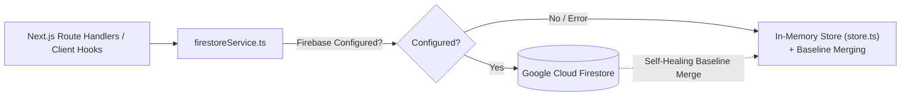

# 🗄️ RIDERS BAY DATABASE & DATA PERSISTENCE SPECIFICATION
> **Cloud Firestore Schemas, Collections, and Local Fallback Architecture**  
> *Project: Riders Bay Smart Scrambler E-Bike | SIEP Season 7.0 (ISIEINDIA)*  
> *Institution: SNJB's KBJ College of Engineering, Chandwad*  
> *Companion Documents:* [.context/ARCHITECTURE.md](file://.context/ARCHITECTURE.md) | [.context/CONTEXT.md](file://.context/CONTEXT.md) | [.context/DECISIONS.md](file://.context/DECISIONS.md) | [.context/HANDOVER.md](file://.context/HANDOVER.md)  
> *Last Synced:* 2026-11-13 (Daily Codebase Context Sync)

---

## 🏗️ 1. DATA PERSISTENCE OVERVIEW

The application utilizes a resilient dual-tier persistence layer:
1. **Primary Cloud Persistence:** Google Cloud Firestore (Firebase SDK `v13.0.0`).
2. **Local Fallback & Baseline Merging:** In-memory + session storage (`web/src/lib/store.ts`) with authoritative baseline merging (`web/src/lib/members.ts`), ensuring 100% offline functionality in the pit-lane or during unconfigured test environments.

---

## 📂 2. FIRESTORE COLLECTIONS & SCHEMAS

### Collection: `tasks`
Stores squad tasks, kanban items, subtasks, sprint metrics, and progress tracking.

| Field | Type | Description |
| :--- | :--- | :--- |
| `id` | `string` | Unique Task ID (`task_<timestamp>_<random>`) |
| `title` | `string` | Short descriptive title of the engineering task |
| `description` | `string` | Detailed technical description and acceptance criteria |
| `teamId` | `TeamId` | Assigned Squad (`chassis`, `powertrain`, `battery`, `software`, etc.) |
| `assignedMembers` | `string[]` | Array of member full names or email identifiers |
| `status` | `string` | `'todo' \| 'in_progress' \| 'review' \| 'done'` |
| `priority` | `string` | `'low' \| 'medium' \| 'high' \| 'urgent'` |
| `dueDate` | `string \| null` | ISO date string (`YYYY-MM-DD`) |
| `createdAt` | `number` | Epoch timestamp in milliseconds |
| `updatedAt` | `number` | Epoch timestamp in milliseconds |
| `subtasks` | `SubTask[]` | Array of subtasks (`{ id, text, completed, completedBy, completedAt }`) |
| `comments` | `TaskComment[]` | Task discussions (`{ id, authorId, authorName, authorTeam, text, createdAt }`) |
| `estimatedHours` | `number` | Estimated hours to complete |
| `actualHours` | `number` | Actual hours spent logged |
| `isBlocked` | `boolean` | Flag indicating task is stalled |
| `blockerReason` | `string` | Description of dependency or physical blocker |

- **Service Functions:** `getFirestoreTasks(teamId?)`, `saveFirestoreTask(task)`, `deleteFirestoreTask(id)`.
- **API Endpoint:** `/api/tasks`.

---

### Collection: `logs`
Records engineering moves, milestone logs, workshop test runs, fabrication steps, and CAD updates.

| Field | Type | Description |
| :--- | :--- | :--- |
| `id` | `string` | Unique Log ID (`log_<timestamp>_<random>`) |
| `stepNumber` | `number` | Sequential engineering step index |
| `stepTitle` | `string` | Heading of the milestone or day's log |
| `phase` | `string` | Project phase (e.g., `'Engineering Move'`, `'Fabrication'`) |
| `status` | `string` | `'in_progress' \| 'testing' \| 'completed' \| 'on_hold' \| 'review'` |
| `teamId` | `TeamId` | Squad identifier responsible for the work |
| `teamName` | `string` | Human-readable squad label |
| `authorName` | `string` | Logging member or lead |
| `date` | `string` | Date string (`YYYY-MM-DD`) |
| `workTime` | `string` | Time window (e.g., `'10:00 AM - 04:00 PM'` or `'14:30'`) |
| `membersPresent` | `string[]` | Roster of members active in this work session |
| `hoursSpent` | `number` | Cumulative hours dedicated |
| `description` | `string` | Comprehensive summary of tasks performed |
| `achievements` | `string` | Key technical outcomes achieved |
| `blockers` | `string \| null` | Challenges or material shortages |
| `videoUrl` | `string \| null` | Streamable preview URL (Google Drive preview or embed) |
| `driveFileId` | `string \| null` | Google Drive File ID for large video evidence |
| `videoSource` | `string \| null` | Upload source indicator (`'drive' \| 'direct' \| 'youtube' \| 'local'`) |
| `createdAt` | `number` | Epoch timestamp |
| `updatedAt` | `number \| null` | Epoch timestamp of last update |

- **Service Functions:** `getFirestoreLogs(teamId?)`, `saveFirestoreLog(log)`, `deleteFirestoreLog(id)`.
- **API Endpoint:** `/api/logs`.

---

### Collection: `materials`
Centralized Research & Technical Materials repository (ADR-019). Houses whitepapers, CAD designs, simulation outputs, component datasheets, test reports, and research briefs.

| Field | Type | Description |
| :--- | :--- | :--- |
| *(Doc ID)* | `string` | Unique Material ID (`mat_<timestamp>_<random>`) |
| `id` | `string` | Matches Document ID |
| `title` | `string` | Document or whitepaper title |
| `description` | `string` | Detailed description, research abstract, or usage notes |
| `category` | `string` | `'research' \| 'specs' \| 'reports' \| 'datasheets' \| 'cad' \| 'other'` |
| `teamId` | `TeamId` | Associated engineering squad |
| `teamName` | `string` | Human-readable squad name |
| `authorEmail` | `string` | Registered Gmail of the uploading member |
| `authorName` | `string` | Display name of the uploading member |
| `fileName` | `string` | Original file name (e.g. `BMS_Thermistor_Analysis.pdf`) |
| `fileSize` | `number` | File size in bytes |
| `mimeType` | `string` | MIME type (e.g. `application/pdf`, `application/zip`) |
| `fileUrl` | `string` | Google Drive view URL or preview stream link |
| `driveFileId` | `string` | Google Drive File ID from resumable upload session |
| `tags` | `string[]` | Searchable categorization tags |
| `createdAt` | `number` | Epoch timestamp in milliseconds |
| `updatedAt` | `number` | Epoch timestamp in milliseconds |

- **Service Functions:** `getFirestoreMaterials(teamId?)`, `saveFirestoreMaterial(material)`, `deleteFirestoreMaterial(id)`.
- **API Endpoint:** `/api/materials` (GET: all materials, POST: open upload for all members, DELETE: author or Core admin only).

---

### Collection: `roster_members`
Dynamic team roster and role governance store (ADR-020, ADR-021). Stores customized member roles, assigned domains, tier levels, appointment statuses, and baseline overrides.

| Field | Type | Description |
| :--- | :--- | :--- |
| *(Doc ID)* | `string` | Unique Member ID (e.g. `core-tirthraj`, `soft-parth`, `mech-meet`) |
| `id` | `string` | Matches Document ID |
| `name` | `string` | Clean First + Last name (zero square brackets) |
| `role` | `string` | Official appointment title (`Core Lead & Captain`, `Vice Captain`, `Software Lead`, etc.) |
| `domains` | `TeamId[]` | Array of assigned engineering squads with 100% equal standing |
| `teamId` | `TeamId` | Backwards-compatibility primary key (matches `domains[0]`) |
| `secondaryTeams` | `TeamId[]` | Backwards-compatibility secondary key (matches `domains.slice(1)`) |
| `isLead` | `boolean` | Squad lead administrative status |
| `isCore` | `boolean` | Master portal-wide executive scope |
| `tier` | `number` | Governance tier (`1`: Core Admin, `2`: Lead, `3`: Member) |
| `email` | `string` | Cleaned lowercase registered Gmail |
| `photoUrl` | `string` | Profile photo URL or lightweight data URL |
| `password` | `string` | Member PIN (revealed in Master Console via eye toggle) |
| `joinedDate` | `string` | Formatted membership join date |
| `status` | `string` | `'active' \| 'inactive' \| 'revoked'` |
| `updatedAt` | `number` | Epoch timestamp of last administrative modification |

- **Self-Healing Baseline Merge:** `getFirestoreMembers()` initializes an in-memory map with the 23 baseline members from `ROSTER_MEMBERS` in `members.ts`, then overlays Firestore documents. If a member hasn't been edited in Firestore, their baseline record is preserved and returned seamlessly.
- **Service Functions:** `getFirestoreMembers()`, `saveFirestoreMember(member)`, `deleteFirestoreMember(id)`.
- **API Endpoints:**
  - `/api/members` — Public, unauthenticated read-only endpoint powering public team pages (`TeamSection.tsx`).
  - `/api/roles` — Administrative endpoint restricted exclusively to Parth Kshirsagar via `isParthMasterAdmin()`.

---

### Collection: `member_profiles`
Stores personalized member identity customizations including display names, custom portrait photos (compressed via HTML5 Canvas), and personal engineering bios.

| Field | Type | Description |
| :--- | :--- | :--- |
| *(Doc ID)* | `string` | Sanitized member email (`cleanEmail.replace(/[^a-zA-Z0-9]/g, '_')`) |
| `email` | `string` | Normalized lowercase email address |
| `displayName` | `string` | User-configured display name (overrides static roster default) |
| `photoUrl` | `string \| null` | Lightweight compressed image data URL (~20–35 KB WebP/JPEG) or storage URL |
| `bio` | `string \| null` | Member's short engineering bio or focus summary |
| `updatedAt` | `number` | Epoch timestamp when the profile was last modified |

- **Service Functions:** `getFirestoreMemberProfiles()`, `saveFirestoreMemberProfile(email, profile)`.
- **API Endpoint:** `/api/profile` (GET all profiles, POST updates for authenticated member).

---

### Collection: `member_passwords`
Individual member authentication PIN storage for the frictionless workshop auth model.

| Field | Type | Description |
| :--- | :--- | :--- |
| *(Doc ID)* | `string` | Sanitized member email (`cleanEmail.replace(/[^a-zA-Z0-9]/g, '_')`) |
| `email` | `string` | Cleaned lowercase email address |
| `password` | `string` | 6-digit workshop PIN (Default fallback: `935200`) |
| `updatedAt` | `number` | Epoch timestamp when last changed |

- **Master Alias Synchronization:** Whenever `saveFirestoreMemberPassword` writes to `parthkshirsagrr@gmail.com` or `parthkshirsagr@gmail.com`, it automatically synchronizes the counterpart alias document so Parth can authenticate seamlessly using either spelling.
- **Service Functions:** `getFirestoreMemberPasswords()`, `saveFirestoreMemberPassword(email, password)`.
- **API Endpoints:** `/api/change-password`, `/api/passwords`, `/api/roles`.

---

### Collection: `team_passwords`
Legacy squad-level PIN collection maintained for backward-compatibility.

| Field | Type | Description |
| :--- | :--- | :--- |
| *(Doc ID)* | `string` | Squad ID (`chassis`, `powertrain`, `software`, etc.) |
| `teamId` | `string` | Squad ID matching document key |
| `password` | `string` | Team-level PIN code |
| `updatedAt` | `number` | Epoch timestamp |

---

## 🛡️ 3. SECURITY & ACCESS PRINCIPLES
- **Self-Healing Fallback:** All API routes query Firestore first; if credentials are missing or the connection is offline, they fall back transparently to `store.ts` without returning 500 errors.
- **Sanitized Email Keys:** Document IDs for email-keyed collections (`member_passwords`, `member_profiles`) are strictly sanitized using regex `/[^a-zA-Z0-9]/g` to ensure valid Firestore path tokens.
- **Client-Side Compression:** Images are compressed via HTML5 Canvas into lightweight WebP/JPEG data URLs (~20–35 KB) prior to persisting to Firestore, preventing document size bloat and staying well within Firestore's 1 MB document limit.
- **Strict Role Security Gate:** Access to modify member roles, permissions, passwords, and assigned squads is verified server-side with `isParthMasterAdmin(session.email)`. Non-Parth accounts receive HTTP 403 Forbidden.
- **Large File Boundary:** Large technical media and video files (>5MB) must route through Google Drive Resumable API sessions, storing only the `driveFileId` and `fileUrl` in Firestore.
