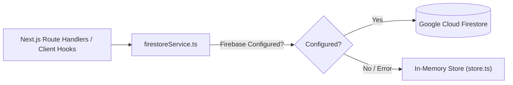

# 🗄️ RIDERS BAY DATABASE & DATA PERSISTENCE SPECIFICATION
> **Cloud Firestore Schemas, Collections, and Local Fallback Architecture**  
> *Project: Riders Bay Smart Scrambler E-Bike | SIEP Season 7.0 (ISIEINDIA)*  
> *Last Synced:* Daily Codebase Context Sync

---

## 🏗️ 1. DATA PERSISTENCE OVERVIEW

The application utilizes a resilient dual-tier persistence layer:
1. **Primary Persistence:** Google Cloud Firestore (Firebase SDK `v13.0.0`).
2. **Local Fallback:** In-memory + session storage (`web/src/lib/store.ts`) ensuring 100% offline or unconfigured functionality during pit-lane or testing environments.

---

## 📂 2. FIRESTORE COLLECTIONS & SCHEMAS

### Collection: `tasks`
Stores squad tasks, kanban items, subtasks, and progress tracking.

| Field | Type | Description |
| :--- | :--- | :--- |
| `id` | `string` | Unique Task ID (`task_<timestamp>_<random>`) |
| `title` | `string` | Short descriptive title of the engineering task |
| `description` | `string` | Detailed technical description and acceptance criteria |
| `teamId` | `TeamId` | Assigned Squad (`chassis`, `powertrain`, `battery`, etc.) |
| `assignedMembers` | `string[]` | Array of member full names or email identifiers |
| `status` | `string` | `'todo' \| 'in_progress' \| 'in_review' \| 'done'` |
| `priority` | `string` | `'low' \| 'medium' \| 'high' \| 'critical'` |
| `dueDate` | `string \| null` | ISO date string (`YYYY-MM-DD`) |
| `createdAt` | `number` | Epoch timestamp in milliseconds |
| `updatedAt` | `number` | Epoch timestamp in milliseconds |
| `subtasks` | `SubTask[]` | Array of subtasks (`{ id, title, completed }`) |
| `comments` | `Comment[]` | Task discussions (`{ id, author, text, timestamp }`) |
| `estimatedHours` | `number` | Estimated hours to complete |
| `actualHours` | `number` | Actual hours spent logged |
| `isBlocked` | `boolean` | Flag indicating task is stalled |
| `blockerReason` | `string` | Description of dependency or physical blocker |

---

### Collection: `logs`
Records engineering moves, milestone logs, workshop test runs, and CAD updates.

| Field | Type | Description |
| :--- | :--- | :--- |
| `id` | `string` | Unique Log ID (`log_<timestamp>_<random>`) |
| `stepNumber` | `number` | Sequential engineering step index |
| `stepTitle` | `string` | Heading of the milestone or day's log |
| `phase` | `string` | Project phase (e.g., `'Engineering Move'`, `'Fabrication'`) |
| `teamId` | `TeamId` | Squad identifier responsible for the work |
| `teamName` | `string` | Human-readable squad label |
| `authorName` | `string` | Logging member or lead |
| `date` | `string` | Date string (`YYYY-MM-DD`) |
| `workTime` | `string` | Time window (e.g., `'10:00 AM - 04:00 PM'`) |
| `membersPresent` | `string[]` | Roster of members active in this work session |
| `hoursSpent` | `number` | Cumulative hours dedicated |
| `description` | `string` | Comprehensive summary of tasks performed |
| `achievements` | `string` | Key technical outcomes achieved |
| `blockers` | `string \| null` | Challenges or material shortages |
| `videoUrl` | `string \| null` | Streamable preview URL |
| `driveFileId` | `string \| null` | Google Drive File ID for large video/CAD evidence |
| `videoSource` | `string \| null` | Upload source indicator (`'gdrive' \| 'direct'`) |
| `createdAt` | `number` | Epoch timestamp |
| `updatedAt` | `number \| null` | Epoch timestamp of last update |

---

### Collection: `member_passwords`
Individual member authentication PIN storage for the frictionless workshop auth model.

| Field | Type | Description |
| :--- | :--- | :--- |
| *(Doc ID)* | `string` | Sanitized member email (e.g. `member_snjb_org`) |
| `email` | `string` | Cleaned lowercase email address |
| `password` | `string` | 6-digit workshop PIN (Default fallback: `935200`) |
| `updatedAt` | `number` | Epoch timestamp when last changed |

---

### Collection: `team_passwords`
Legacy squad-level PIN collection maintained for backward-compatibility.

| Field | Type | Description |
| :--- | :--- | :--- |
| *(Doc ID)* | `string` | Squad ID (`chassis`, `powertrain`, etc.) |
| `teamId` | `string` | Squad ID matching document key |
| `password` | `string` | Team-level PIN code |
| `updatedAt` | `number` | Epoch timestamp |

---

## 🛡️ 3. SECURITY & ACCESS PRINCIPLES
- **No Mock Tasks in Production:** Seed / mock task injection is disabled; all tasks originate from authenticated squad members.
- **PIN Sanitation:** Email document IDs are sanitized with regex `/[^a-zA-Z0-9]/g` to ensure clean Firestore paths.
- **Fail-Safe Fallback:** If Firestore connection fails or environment credentials are missing, API routes transparently fallback to in-memory state without crashing UI or throwing 500 errors to client.
